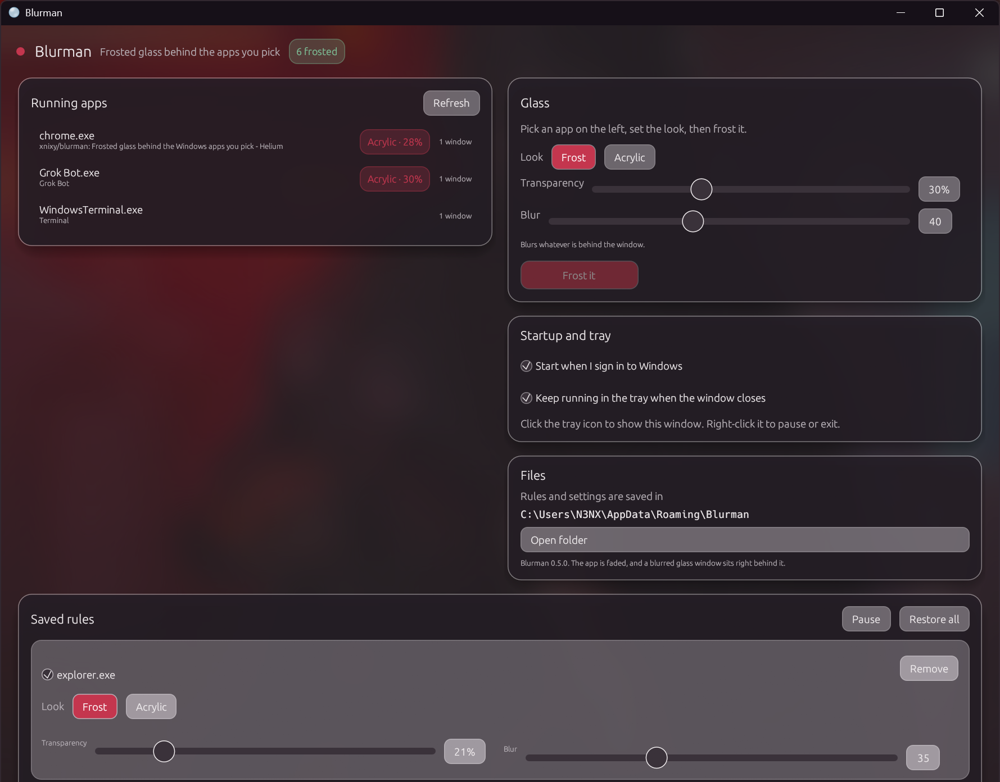

# Blurman

Frosted glass behind the Windows apps you pick. Chrome, Edge, Electron apps, Notepad, Explorer, and anything else with a normal window.


<p align="center"></p>

## Features

- Pick any running app, choose **Frost** or **Acrylic**, set **transparency** and **blur**, and press **Frost it**. Sliders apply live. Frost blurs what is behind the window. Acrylic is the milky system glass, and its slider sets how milky it is.
- **Pick a window** steps Blurman aside so you can click the window you mean instead of finding it in the list. Esc or a right-click cancels.
- **Finish** adds a **tint** (a color you pick, or one that follows the Windows theme or accent color), **saturation** from grey to vivid, and fine **grain**. Acrylic takes the tint color too.
- **Presets** put a saved look on any app with one click. Blurman comes with Subtle, Heavy glass, Vibrant, Smoke, and Milky. **Save as…** keeps your own, and right-clicking one deletes it.
- **Behavior** is per app. **While you use it** can stay the same (the default), turn **Lighter**, or go **Solid** while the app has focus, fading back to frosted when you move on. **Only titles** and **Skip titles** frost some of an app's windows and not others, like every Chrome window except YouTube. Titles are checked again as they change.
- New glass eases into focus instead of snapping on.
- Rules are saved per app and come back on every new window of that app. New windows are faded the moment the app creates them, so they never appear solid first. **Saved rules** switches each rule on or off and adjusts it in place, and **Edit** opens every setting for that app.
- On Windows 11 the Blurman window is frosted glass itself, using the system acrylic backdrop.
- **Pause** puts every app back without deleting rules. **Restore all** deletes them.
- **Auto-pause** does the same on its own while battery saver is on, during Do not disturb or presentation mode, or between two times of day, and frosts the apps again when that ends.
- **Shortcuts** work from any app, even while Blurman is in the tray. Click one to change it, then press the new keys.

  | Default | Does |
  | --- | --- |
  | Ctrl+Alt+B | Pause or resume |
  | Ctrl+Alt+F | Frost the app in front, or switch its rule off |
  | Ctrl+Alt+Z | Hold to see every frosted app solid |
  | Ctrl+Alt+PageUp / PageDown | Make the app in front more or less see-through |

- **Start with Windows** runs Blurman quietly in the tray at sign-in. **Keep in tray on close** does the same for normal launches, so apps stay frosted while the window is closed. The tray menu pauses, switches single apps on or off, and frosts the last app you used.
- **Check for updates** asks GitHub once a day whether a newer Blurman is out and shows a link if one is. Nothing is downloaded.
- Glass follows the app as you move, resize, minimize, or switch virtual desktops.
- Fullscreen windows are left alone, so a game or a video that covers the screen is not faded.
- If Blurman crashes or is killed, the next start (or `blurman clear --all`) puts every app back.

## Requirements

- Windows 11 for adjustable blur, saturation, and grain. Windows 10 works with system acrylic, where the blur slider sets how milky the glass is and the tint sets its color.
- [Rust](https://rustup.rs) stable, with the MSVC toolchain (`stable-x86_64-pc-windows-msvc`, the rustup default on Windows).
- Visual Studio Build Tools with the **Desktop development with C++** workload, which provides the MSVC linker and Windows SDK. rustup offers to install it if it is missing.

## Download

Each push to `main` builds `blurman.exe` and publishes it on the [releases page](https://github.com/xnixy/blurman/releases). The file is not signed, so Windows SmartScreen may warn the first time you open it.

Each release also carries `winget-manifests.zip`, a ready [winget](https://learn.microsoft.com/windows/package-manager/) manifest for that build. To list Blurman in winget, unpack it and submit it with `wingetcreate submit <folder>`, or open a pull request with it to [microsoft/winget-pkgs](https://github.com/microsoft/winget-pkgs).

## Build

```powershell
git clone https://github.com/xnixy/blurman.git
cd blurman
cargo build --release
```

The app is `target\release\blurman.exe`. It is a single file with no installer. Copy it anywhere and run it. If you use **Start with Windows**, turn it on again after moving the exe, or just open Blurman once from the new location and it updates the startup entry itself.

Run the tests with `cargo test`.

## Use

Run `blurman.exe` to open the window. Running it again brings the window forward, or opens it if Blurman is in the tray.

There is also a command line, handy for scripts, AutoHotkey, or a Stream Deck:

```powershell
blurman list                                        # visible apps Blurman can frost
blurman apply chrome.exe --transparency 30 --blur 40 --style frost    # save a rule; opens Blurman if needed
blurman apply notepad.exe --transparency 30 --blur 60 --style acrylic # milky glass; blur sets how milky it is
blurman apply code.exe --preset Vibrant --focus solid                 # start from a preset; solid while you type
blurman apply chrome.exe --tint "#1a2b3c" --tint-amount 30 --saturation 150 --grain 20
blurman apply chrome.exe --tint-from accent         # follow the Windows accent color
blurman apply chrome.exe --skip-title YouTube --skip-title Netflix    # leave those windows alone
blurman apply chrome.exe --skip-title ""            # clear the skip list
blurman clear chrome.exe                            # remove one rule
blurman clear --all                                 # remove every rule and put every app back
blurman pause                                       # also: resume, toggle
blurman status                                      # what is frosted; --json for scripts
blurman export my-glass.json                        # rules and presets to a file
blurman import my-glass.json                        # add them back; --replace to start over
```

Options you leave out of `apply` keep the app's current values. Transparency ranges from 10 to 70 percent, blur from 1 to 100, tint amount from 0 to 80, saturation from 0 to 200 (100 leaves colors as they are), and grain from 0 to 100. `--style` is `frost` (the default) or `acrylic`, `--tint-from` is `custom`, `theme`, or `accent`, and `--focus` is `same`, `lighter`, or `solid`. A title pattern matches anywhere in the title, and `*` is a wildcard.

Rules live in `%APPDATA%\Blurman\rules.json` and settings, shortcuts, and presets in `settings.json` next to it. **Start with Windows** adds a `Blurman` entry under `HKCU\Software\Microsoft\Windows\CurrentVersion\Run`.

To try a build without touching your own setup, set `BLURMAN_PROFILE` to a name such as `test`. That Blurman keeps its files in `%APPDATA%\Blurman-test`, uses its own startup entry, and runs beside your usual one. Do not give both a rule for the same app, or they fight over its windows.

## How it works

Windows cannot blur only the background of another app's window, so Blurman does two things. It fades the whole app with layered-window alpha, and it places a glass window of its own directly behind the app. The glass uses Windows composition to Gaussian-blur whatever is behind it, so what shows through the faded app is frosted instead of sharp. The blurred backdrop then goes through a saturation effect, a tint layer, and a tiled grain texture, and every slider changes those live without rebuilding the glass. Acrylic uses Windows' own milky blur instead, and its slider sets how milky that glass is. Because the fade applies to the whole window, text fades a little too. Transparency is capped at 70 percent so it stays readable, and setting **While you use it** to **Solid** keeps an app fully readable while you work in it.

Blurman watches window events, so a new window of a ruled app is faded as soon as the app creates it, usually before it is first drawn. The glass is added a few milliseconds later, when the window appears. Blurman only changes the window's style from outside the app; it never injects code into other processes.

Apps running as administrator can only be frosted when Blurman runs as administrator too. They show an **Admin** badge in the app list.

## License

[MIT](LICENSE)
